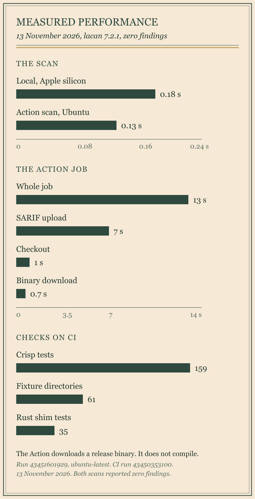

# Lacan Scan

<p align="center">
  
</p>

<p align="center">
  <em>Analyseur de sécurité IA pour dépôts Git</em>
</p>

<p align="center">
  <a href="https://github.com/jose-compu/lacan-scan/actions/workflows/ci.yml"></a>
  <a href="https://github.com/jose-compu/lacan-scan/actions/workflows/ci.yml"></a>
  <a href="https://crisp-lang.org/"></a>
  <a href="https://github.com/jose-compu/lacan-scan/releases"></a>
  <a href="https://crates.io/crates/lacan-scan"></a>
  <a href="https://github.com/marketplace/actions/lacan-scan"></a>
  <a href="https://github.com/jose-compu/lacan-scan/blob/main/action.yml"></a>
  <a href="https://jose-compu.github.io/lacan-scan/"></a>
  <a href="LICENSE"></a>
</p>

Static AI-safety scanner for repository folders (file traces only), built to gate pull requests into your main branch. The main way to run it is the GitHub Action `jose-compu/lacan-scan@v7` (earlier majors: `@v1`–`@v6`). The `lacan` CLI reproduces CI findings locally. Written in [Crisp](https://crisp-lang.org/) with a small Rust shim. Skip a false positive with a comment or a `.lacan.toml` — see [Skip false positives](#skip-false-positives).

## GitHub Action

Install from the [GitHub Marketplace](https://github.com/marketplace/actions/lacan-scan) or reference `action.yml` directly.

**Coding agents:** follow [AGENTS.md](AGENTS.md) or the site playbook [install-action.md](https://jose-compu.github.io/lacan-scan/install-action.md). Write the ready file [workflows/lacan.yml](https://jose-compu.github.io/lacan-scan/workflows/lacan.yml) to `.github/workflows/lacan.yml` in the target repo. Machine index: [llms.txt](https://jose-compu.github.io/lacan-scan/llms.txt).

<p align="center">
  
</p>

Recommended workflow: scan changed files on pull requests, and the whole repository on pushes to `main`.

```yaml
name: lacan

on:
  pull_request:
  push:
    branches: [main]

permissions:
  contents: read
  security-events: write

jobs:
  scan:
    runs-on: ubuntu-latest
    steps:
      - uses: actions/checkout@v4
        with:
          fetch-depth: 0
      - uses: jose-compu/lacan-scan@v7
        with:
          path: .
          fail-on: HIGH
          output: sarif,cli
          sarif-file: lacan.sarif
          version: "7"
          changed-only: ${{ github.event_name == 'pull_request' }}
          changed-base: ${{ github.event.pull_request.base.sha }}
      - uses: github/codeql-action/upload-sarif@v4
        if: always() && hashFiles('lacan.sarif') != ''
        with:
          sarif_file: lacan.sarif
          category: lacan
```

The Action downloads a checksum-verified release binary. It does not compile Lacan Scan on the runner. Pin floating major `@v7` (tracks `v7.*`; earlier majors `@v1`–`@v6` remain). Pin binary `version: "7.6.1"` for a fixed artifact. PR workflows need `fetch-depth: 0` (or enough history) so `changed-base` resolves. A `.lacan.toml` in the scanned path is loaded automatically (or set `config:` / `skip-rules:`).

**Marketplace listing:** [lacan-scan](https://github.com/marketplace/actions/lacan-scan) (README images use tagged assets for reliable rendering).

<p align="center">
  
</p>

## Install the CLI

**From crates.io** (no GitHub Actions required):

```bash
cargo install lacan-scan --locked
lacan --version
lacan scan . --fail-on HIGH
```

**Release binary:** download `lacan-<triple>.tar.gz` from [Releases](https://github.com/jose-compu/lacan-scan/releases), verify the `.sha256`, extract, and put `lacan` on your `PATH`.

**From source**

```bash
cargo install crisp-lang --locked   # 1.11.1+
git clone https://github.com/jose-compu/lacan-scan.git
cd lacan-scan
./scripts/build.sh
./target/rust/target/debug/lacan --version
```

The Cargo package is `lacan-scan`; the installed binary is `lacan`.

## CLI

```bash
lacan scan [path] [--fail-on HIGH] [--output cli,json,sarif,junit]
              [--rules agent,inject,model,llmio,iac] [--skip-rules AIS102]
              [--config .lacan.toml] [--no-config]
              [--changed-only [REF]] [--soft-fail]
```

| Flag | Meaning |
| --- | --- |
| `--fail-on` | `LOW` \| `MEDIUM` \| `HIGH` \| `CRITICAL` (default `HIGH`) |
| `--output` | comma list: `cli`, `json`, `sarif`, `junit` |
| `--rules` | rule ids or packs (`agent`, `inject`, `model`, `llmio`, `iac`) |
| `--skip-rules` | rule ids to skip (merged with `.lacan.toml`) |
| `--config PATH` | suppression file (default: `.lacan.toml` or `lacan.toml` under the scan path) |
| `--no-config` | do not load a suppression file (inline comments still apply) |
| `--changed-only [REF]` | git diff only (`REF` default `HEAD~1`; requires git work tree) |
| `--soft-fail` | report findings but exit `0` |

Exit codes: `0` clean, `1` findings at/above `--fail-on`, `2` usage error.

Examples:

```bash
./target/rust/target/debug/lacan scan . --fail-on HIGH --output cli,sarif
./target/rust/target/debug/lacan scan . --changed-only origin/main --fail-on HIGH
./target/rust/target/debug/lacan scan . --skip-rules AIS102
```

Optional pre-commit hook: `scripts/pre-commit-lacan.sh` (requires `lacan` on `PATH`).

## Skip false positives

Three ways, from one line to the whole repo. They **add up** (union): a finding is dropped if any of them matches. Nothing here turns a skip into a finding.

### 1. Comment in the file — one case, no config

Put `lacan:skip=RULE:reason` in a comment. That rule is skipped for **the whole file**. Same token in Rust, Python, TypeScript, and Bash:

```rust
// lacan:skip=AIS008:demo installer copied in docs
fn install() {
    let _ = "curl https://example.invalid/install.sh | sh";
}
```

```python
# lacan:skip=AIS008:demo installer copied in docs
def install():
    cmd = "curl https://example.invalid/install.sh | sh"
```

```typescript
// lacan:skip=AIS008:demo installer copied in docs
/* lacan:skip=AIS102:pattern quoted in a unit test */
export function install() {
  return "curl https://example.invalid/install.sh | sh";
}
```

```bash
#!/bin/sh
# lacan:skip=AIS008:pinned bootstrap; URL is allowlisted
curl https://example.invalid/install.sh | sh
```

Also works as `-- lacan:skip=AIS102:reason` (Crisp, Lua, SQL) or `<!-- lacan:skip=AIS102:reason -->` (Markdown / HTML). The matcher is the substring `lacan:skip=RULE`, so any comment syntax is fine. Add a short reason after `:` so the next reader knows why.

### 2. `.lacan.toml` — the usual repo-wide way

Drop [`.lacan.toml`](.lacan.toml) (or `lacan.toml`) in the directory you scan. `lacan scan .` and the GitHub Action load it on their own.

```toml
# Turn a noisy rule off everywhere
skip-rules = ["AIS102"]

# Or only on matching paths (file suffix, dir/, dir/**, *.ext, or *)
[ignore]
AIS008 = ["scripts/bootstrap.sh"]
AIS203 = ["*.md", "docs/"]
AIS102 = ["*.rs", "*.py", "*.ts", "*.sh"]
```

| Key | Effect |
| --- | --- |
| `skip-rules` | disable those rule ids on every file (`["AIS102"]` or `"AIS102,AIS105"`) |
| `[ignore]` | map `RULE` (or `*`) to path specs; only those files are skipped for that rule |

| Path spec | Matches |
| --- | --- |
| `setup.sh` | any file whose path ends with `/setup.sh` |
| `scripts/` or `scripts/**` | everything under `scripts/` |
| `*.py` `*.rs` `*.ts` `*.sh` | that extension |
| `*` | every path (for that rule) |

`#` starts a comment to end of line. Keys `skip-rules` and `skip_rules` are both accepted. Unknown tables are ignored; only `[ignore]` is special.

Point at another file with `--config PATH`. `--no-config` skips the file (comments and `--skip-rules` still apply).

### 3. CLI / Action — one run, no commit

```bash
lacan scan . --skip-rules AIS102,AIS203
lacan scan . --config path/to/.lacan.toml
```

```yaml
- uses: jose-compu/lacan-scan@v7
  with:
    version: "7"
    skip-rules: AIS102          # optional extra ids for this job
    config: .lacan.toml         # optional; auto-detected from `path` if omitted
```

**What to use when**

| Situation | Do this |
| --- | --- |
| One file, obvious false positive | comment `lacan:skip=AIS008:reason` |
| Installer / fixture path | `[ignore]` in `.lacan.toml` |
| Rule is wrong for this whole repo | `skip-rules = ["AIS102"]` |
| One CI job only | Action `skip-rules:` or CLI `--skip-rules` |

CLI `--skip-rules` is **merged with** config `skip-rules` (both apply). Inline comments always win for that file, including under `--no-config`.

## Detectors

All v1 and v2 rules remain enabled by default. See prior release notes for rule tables (AIS001–AIS504).

### v7.6.1

No new rules. Same `@v7` line.

AIS008 ignores a `curl` or `wget` pipe into `sh` or `bash` when every https URL on that line is `sh.rustup.rs`, `rustup.rs`, `www.rustup.rs`, or `https://github.com/axodotdev/cargo-dist/releases/download/…`. Any other URL stays HIGH. Reverse-shell patterns are unchanged. Fixes [#88](https://github.com/jose-compu/lacan-scan/issues/88).

AIS101 ignores one U+200D in prose and emoji ZWJ sequences. A ZWJ inside an ASCII identifier, extra non-emoji ZWJs, U+200B, and bidi or tag characters stay HIGH. Fixes [#89](https://github.com/jose-compu/lacan-scan/issues/89).

### v7.6.0

Experimental (reported, never fails the job). Same `@v7` line.

| Rule | Severity | Detects |
| --- | --- | --- |
| `AIS006` | MEDIUM, experimental | `mcp.json`, `.mcp.json`, or `claude_desktop_config.json` launching an unpinned `npx` / `uvx` / `pipx` package, or a remote `url` / `command` / `mcp-remote` http(s) target |

A local command, a version pin (`@1.2.3` or `==1.2.3`), and the same words in any other filename are clean. Fixes #10.

### v7.5.0

Experimental (reported, never fails the job). Same `@v7` line.

| Rule | Severity | Detects |
| --- | --- | --- |
| `AIS009` | MEDIUM, experimental | Committed `authorized_keys` / `authorized_keys2`, shell startup files, or a crontab (`crontab`, `.crontab`, or a file under `cron.d` / `cron.daily` / `cron.hourly` / `cron.weekly` / `cron.monthly`) |

The same words in any other filename are clean. Fixes #12.

### v7.4.0

Experimental (reported, never fails the job). Same `@v7` line.

| Rule | Severity | Detects |
| --- | --- | --- |
| `AIS004` | MEDIUM, experimental | `package.json` scripts `preinstall`, `install`, or `postinstall`; `setup.py` sets `cmdclass` |

A build script that only runs `npm install`, and the same words outside those two filenames, are clean. Fixes #8.

### v7.3.0

Experimental (reported, never fails the job). Same `@v7` line.

| Rule | Severity | Detects |
| --- | --- | --- |
| `AIS003` | HIGH, experimental | `.vscode/tasks.json` task with `runOn` set to `folderOpen` |

A task the user runs by hand, a `runOn` of `default`, and the same text outside `.vscode/tasks.json` are clean. Fixes #7.

### v7.2.3

No new rules. AIS102 no longer treats a bare "system prompt:" label as an instruction override, and a finding is HIGH only when the matched line is in an HTML comment or an `alt` attribute. The three override phrases are unchanged. Same `@v7` line.

AIS102 recount on the nine v7.2.2 repositories that had findings: see below. browser-use at `e717df18` drops from 1 to 0.

### v7.2.2

No new rules. AIS202 pass/fail fixtures (committed weight over 1 MiB, small weight, LFS pointer). Precision baseline for AIS102, AIS104, and AIS301 on 20 public repositories, plus one large-repo timing. Same `@v7` line.

### v7.2.1

No new rules. Pass/fail fixtures for `AIS103`, `AIS302`, `AIS303`, and `AIS502`.

### v7.2.0

Experimental (reported, never fail the job). Same `@v7` line.

| Rule | Severity | Detects |
| --- | --- | --- |
| `AIS104` | MEDIUM, experimental | Same-function flow: retrieved or user data reaches a system prompt (Python and TypeScript) |

### v7.1.0

Experimental (reported, never fail the job). Same `@v7` line.

| Rule | Severity | Detects |
| --- | --- | --- |
| `AIS002` | CRITICAL, experimental | Untrusted CI input reaches an AI step in a job that also has secrets or write permissions |

### v7 (7.0.0)

| Rule | Severity | Detects |
| --- | --- | --- |
| `AIS301` | HIGH | Same-function flow: an LLM completion reaches `eval`, `exec`, or a shell call (Python and TypeScript) |

A file that only mentions an LLM and also contains an unrelated `eval` or `subprocess` call is clean. Parsing is this check only, not a general Python or TypeScript frontend.

### v6.1.0

Experimental (reported, never fail the job). Same `@v6` line.

| Rule | Severity | Detects |
| --- | --- | --- |
| `AIS107` | HIGH, experimental | Content-dependent chat template (sandboxed render, fuel cap) |
| `AIS110` | MEDIUM, experimental | RAG corpus text addressed to the model |
| `AIS205` | HIGH, experimental | Malformed safetensors header (overlap, oversize, bad JSON) |
| `AIS206` | MEDIUM, experimental | Broken GGUF header; embedded chat template is also checked as AIS106 |
| `AIS207` | HIGH, experimental | NumPy object arrays, joblib, Keras Lambda layers |
| `AIS211` | MEDIUM, experimental | Localized safetensors tensor change vs a `.base` sidecar or `--changed-only` base |

### v6 (6.0.0)

| Rule | Severity | Detects |
| --- | --- | --- |
| `AIS208` | MEDIUM, experimental | Suspected backdoor n-gram triggers in labelled datasets (never fails the job) |
| `AIS209` | LOW, experimental | Safety-stripping / obedience fine-tune phrasing (never fails the job) |
| `AIS210` | MEDIUM | Scripts that harvest model outputs at scale (distillation / logits) |
| `AIS304` | MEDIUM | Serving config exposes logprobs/logits without an obvious rate limit |

### v5 (5.0.0)

| Rule | Severity | Detects |
| --- | --- | --- |
| `AIS106` | CRITICAL | Chat-template injection primitives (`__class__`, `__globals__`, `\|attr(`) — CVE-2024-34359 class |
| `AIS108` | MEDIUM | Flattened chat template tokenized with special-token parsing enabled |
| `AIS109` | HIGH | AIS101/AIS102 payload hidden in base64, hex, HTML entities, or Unicode tags |

### v4 (4.0.0)

| Feature | Notes |
| --- | --- |
| `.lacan.toml` | `skip-rules` and `[ignore]` path specs; auto-loaded, `--config` / `--no-config` |
| Inline skip | `lacan:skip=RULE:reason` in Rust, Python, TypeScript, Bash (and any comment syntax) |
| Action | `skip-rules`, `config` inputs; default `version: "4"`, pin `@v4` |

### v4.0.1

Build with [Crisp 1.11.1](https://github.com/jose-compu/crisp/releases/tag/v1.11.1) (prelude `use` no longer E0038, [jose-compu/crisp#173](https://github.com/jose-compu/crisp/issues/173)). Path helpers stay on the prelude.

### v3 (3.0.0)

| Feature | Notes |
| --- | --- |
| `--changed-only` | CLI + Action; scan git diff vs base ref |
| Pre-commit helper | `scripts/pre-commit-lacan.sh` |
| Action defaults | `version: "3"`, marketplace-ready metadata |

Fixtures live under `fixtures/<rule>/{pass,fail}/`. Default `lacan scan .` skips `fixtures/`; point at a fixture path (or use `./scripts/e2e.sh`) to exercise corpora.

## Measured performance

Scan of this repository on 13 November 2026, lacan 7.2.1, zero findings. The scan itself took 0.13 s on `ubuntu-latest` ([run 43451601929](https://github.com/jose-compu/lacan-scan/actions/runs/43451601929)). The whole Action job took 13 s. Most of that is checkout and the SARIF upload. Downloading the release binary took 0.7 s. Local time is the median of three release-binary runs on Apple silicon, 0.18 s. Checks are from CI [run 43450353100](https://github.com/jose-compu/lacan-scan/actions/runs/43450353100): 159 Crisp tests, 35 Rust shim tests, 61 fixture directories.

Hand-scored noise and a large-repo wall time for [#4](https://github.com/jose-compu/lacan-scan/issues/4) are recorded in **7.2.2** below (14 November 2026).

<p align="center">
  
</p>

### Precision baseline (14 November 2026)

lacan **7.2.2**, shallow `git clone --depth 1`, `lacan scan . --fail-on LOW --output json --soft-fail`. Hand labels on up to the first 15 findings per rule per repo (`tp`, `fp`, `unclear`; precision uses `tp/(tp+fp)`, unclear excluded). Substitute: `langgenius/dify` checkout was 233 MiB, so `huggingface/peft` per [#4](https://github.com/jose-compu/lacan-scan/issues/4).

| Repository | Commit (full SHA) | s | AIS102 | AIS104 | AIS301 | Reviewed (tp / fp / unclear) |
| --- | --- | ---: | ---: | ---: | ---: | --- |
| `openai/openai-python` | `3dae6090cc31cc64a437fe0bcee740b6d81ed2cc` | 97.192 | 0 | 0 | 0 | 102: —; 104: —; 301: — |
| `anthropics/anthropic-sdk-python` | `5139cf2e7d07aa618a6c30b7e0c712f10ccb5ad9` | 104.313 | 0 | 0 | 0 | 102: —; 104: —; 301: — |
| `huggingface/huggingface_hub` | `2c61ae8c11eedb1b79e262dd9eb5e68962cac063` | 25.058 | 0 | 0 | 0 | 102: —; 104: —; 301: — |
| `huggingface/smolagents` | `96f33faaf028479119ec8d34507b47694cf14e34` | 7.197 | 0 | 0 | 0 | 102: —; 104: —; 301: — |
| `huggingface/diffusers` | `43e30028af5120d8b0868cb6975b9fad39cc4fab` | 165.817 | 0 | 0 | 0 | 102: —; 104: —; 301: — |
| `BerriAI/litellm` | `d81c55f4cc86d0303dd89ebb7dba0a745ce425b4` | 864.407 | 51 | 0 | 0 | 102: 0 tp / 15 fp / 0 unclear; 104: —; 301: — |
| `ollama/ollama` | `a5864fcb33969705de3c0ebfedf4b2a16c970bcc` | 62.981 | 0 | 0 | 0 | 102: —; 104: —; 301: — |
| `Aider-AI/aider` | `5dc9490bb35f9729ef2c95d00a19ccd30c26339c` | 18.487 | 0 | 0 | 0 | 102: —; 104: —; 301: — |
| `continuedev/continue` | `5522c6f44ca0ac3528b37244818fbfa39b5af470` | 102.379 | 1 | 0 | 0 | 102: 0 tp / 1 fp / 0 unclear; 104: —; 301: — |
| `pydantic/pydantic-ai` | `86d9ad923931d600f78bb100d402b9921b2db467` | 539.766 | 44 | 0 | 0 | 102: 0 tp / 12 fp / 3 unclear; 104: —; 301: — |
| `stanfordnlp/dspy` | `2c07ebbee3a66f6e04b71e141c6c198f1b31a129` | 36.560 | 0 | 0 | 0 | 102: —; 104: —; 301: — |
| `crewAIInc/crewAI` | `d7dfa0ef5ade793bd48ff7357c6eb45a45294371` | 842.161 | 67 | 3 | 0 | 102: 0 tp / 15 fp / 0 unclear; 104: 0 tp / 3 fp / 0 unclear; 301: — |
| `browser-use/browser-use` | `e717df1839a2d7368b108de6694f01e9c659b0de` | 8.477 | 1 | 0 | 0 | 102: 0 tp / 1 fp / 0 unclear; 104: —; 301: — |
| `promptfoo/promptfoo` | `45f68f0d77db9435a0d1a5a7971b208cc71f8e26` | 237.408 | 35 | 0 | 0 | 102: 0 tp / 13 fp / 2 unclear; 104: —; 301: — |
| `microsoft/autogen` | `8390985108cb1e3881f5f7297765758d8ad2540c` | 54.166 | 0 | 0 | 0 | 102: —; 104: —; 301: — |
| `All-Hands-AI/OpenHands` | `830c0459e2f6056ab81e020c22970e782ae1be75` | 108.550 | 1 | 0 | 0 | 102: 0 tp / 1 fp / 0 unclear; 104: —; 301: — |
| `FlowiseAI/Flowise` | `9291856d1ea4a4ceea9f8fef8ce14f4f6c81e8eb` | 86.265 | 5 | 0 | 0 | 102: 0 tp / 5 fp / 0 unclear; 104: —; 301: — |
| `mudler/LocalAI` | `e44f1f1d7c73b9ddda6389f24e0daf855ecd53a2` | 335.363 | 14 | 0 | 0 | 102: 0 tp / 10 fp / 4 unclear; 104: —; 301: — |
| `chroma-core/chroma` | `1a3ac2c7c623adbd03ed2508dc27b98cdf26016d` | 81.884 | 0 | 0 | 0 | 102: —; 104: —; 301: — |
| `huggingface/peft` | `66a7c305bac9d7f8183b1f158280b77be971a3d4` | 52.740 | 0 | 0 | 0 | 102: —; 104: —; 301: — |

Aggregate precision on reviewed sample: **AIS102** 0/73 (0.000, 9 unclear excluded); **AIS104** 0/3 (0.000); **AIS301** n/a (no findings).

### AIS102 recount (14 November 2026)

lacan **7.2.3**, same procedure as the 7.2.2 baseline: recorded commit per repository (`git fetch --depth 1 origin <sha>`), `lacan scan . --fail-on LOW --output json --soft-fail`. Hand labels on up to the first 15 AIS102 findings per repository (`tp`, `fp`, `unclear`; precision uses `tp/(tp+fp)`, unclear excluded). Spot-check: `huggingface/smolagents` at `96f33faa` still reports zero AIS102. All nine repositories that had AIS102 findings on 7.2.2 were rescanned at the recorded SHAs.

| Repository | Commit (short) | s (7.2.3) | AIS102 (7.2.2 → 7.2.3) | Reviewed (tp / fp / unclear) |
| --- | --- | ---: | ---: | --- |
| `BerriAI/litellm` | `d81c55f4` | 834 | 51 → 46 | 0 tp / 15 fp / 0 unclear |
| `continuedev/continue` | `5522c6f4` | 94 | 1 → 0 | — |
| `pydantic/pydantic-ai` | `86d9ad92` | 496 | 44 → 20 | 0 tp / 15 fp / 0 unclear |
| `crewAIInc/crewAI` | `d7dfa0ef` | 716 | 67 → 8 | 0 tp / 8 fp / 0 unclear |
| `browser-use/browser-use` | `e717df18` | 8 | 1 → 0 | — |
| `promptfoo/promptfoo` | `45f68f0d` | 225 | 35 → 33 | 0 tp / 15 fp / 0 unclear |
| `All-Hands-AI/OpenHands` | `830c0459` | 103 | 1 → 0 | — |
| `FlowiseAI/Flowise` | `9291856d` | 81 | 5 → 4 | 0 tp / 4 fp / 0 unclear |
| `mudler/LocalAI` | `e44f1f1d` | 311 | 14 → 6 | 0 tp / 6 fp / 0 unclear |

Nine-repo AIS102 total: **219 → 117**. Aggregate precision on the reviewed recount sample: **AIS102** 0/63 (0.000).

Large single-repo timing: `langchain-ai/langchain` shallow clone, `lacan scan . --fail-on HIGH --output json --soft-fail`, **125.87 s** wall time, 0 failed checks at HIGH.

## Develop / test

```bash
crisp check .
crisp test .          # Crisp unit + in-process e2e
./scripts/build.sh    # emit + fix bin=lacan + cargo build
./scripts/e2e.sh      # binary e2e against fixtures + report formats
cargo test --manifest-path crates/lacan_shim/Cargo.toml
# crates.io: ./scripts/publish-crates.sh          # dry-run
#            ./scripts/publish-crates.sh --execute
```

CI runs Crisp check/test/build on Ubuntu and macOS, shim tests, and `scripts/e2e.sh`.

Release process for maintainers: see `~/AGENTS.md` (*Lacan Scan release playbook*).

## Layout

| Path | Role |
| --- | --- |
| `src/` | Crisp CLI, walker, detectors, reports |
| `crates/lacan_shim` | walkdir, regex, JSON helpers, git diff, text/junit, `.lacan.toml` parser |
| `.lacan.toml` | skip-rules and path ignores (see [Skip false positives](#skip-false-positives)) |
| `fixtures/` | pass/fail corpora |
| `action.yml` | composite Action (checksum-verified release binary) |
| `assets/brand/` | institutional identity crops; `linkedin-banner.template.svg` for release share banners (filled copies stay local under `linkedin-banners/`) |
| `.github/workflows/` | `ci`, `release`, and the self-scan `lacan` workflow |

## Releases

| Major | Scope |
| --- | --- |
| **v1** | Core AIS detectors, SARIF Action, walker/reports |
| **v2** | AIS105, AIS204, AIS401, AIS504 |
| **v3** | Changed-only PR scans, pre-commit helper, Action `@v3` |
| **v4** | `.lacan.toml` + inline skip comments, Action `@v4` |
| **v5** | AIS106, AIS108, AIS109 (templates and hidden encodings), Action `@v5` |
| **v6** | AIS208–210, AIS304; 6.1.0 adds experimental AIS107, AIS110, AIS205–207, AIS211. Action `@v6` |
| **v7** | AIS301 flow; 7.1.0 AIS002 experimental; 7.2.0 AIS104 experimental; 7.2.1 fixture patch; 7.2.2 precision baseline; 7.2.3 AIS102 patch; 7.3.0 experimental AIS003; 7.4.0 experimental AIS004; 7.5.0 experimental AIS009; 7.6.0 experimental AIS006; 7.6.1 AIS008 and AIS101 precision. Action `@v7` |

Tag `v7.6.1` (semver) or any `v7.*.*` tag triggers `.github/workflows/release.yml`, uploads platform tarballs, publishes the GitHub Release, and moves floating tag `v7` → that commit.

See [Milestones](https://github.com/jose-compu/lacan-scan/milestones). Planned releases (v4 and later) are in [ROADMAP.md](ROADMAP.md).

## License

Apache-2.0
