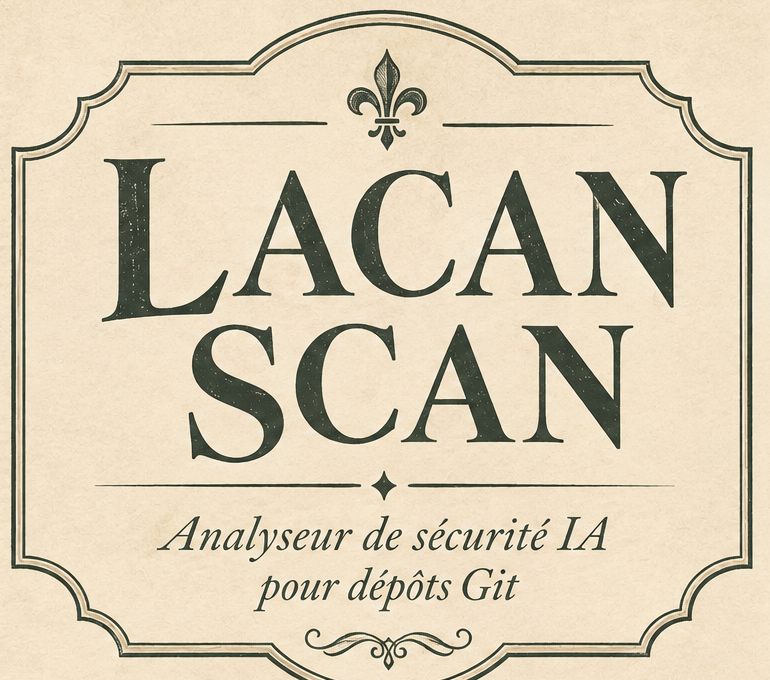

# Lacan Scan

<p align="center">
  
</p>

<p align="center">
  <em>Analyseur de sécurité IA pour dépôts Git</em>
</p>

Static AI-safety scanner for repository folders (file traces only). Written in [Crisp](https://crisp-lang.org/) with a small Rust shim. Ship as CLI `lacan` and GitHub Action `jose-compu/lacan-scan@v1`.

## Install

**Release binary** (after `v1.0.0` is published): download `lacan-<triple>.tar.gz` from [Releases](https://github.com/jose-compu/lacan-scan/releases), verify the `.sha256`, extract, and put `lacan` on your `PATH`.

**From source**

```bash
cargo install crisp-lang --locked   # 1.11+
git clone https://github.com/jose-compu/lacan-scan.git
cd lacan-scan
crisp build .
./target/rust/target/debug/lacan --version
```

## CLI

```bash
lacan scan [path] [--fail-on HIGH] [--output cli,json,sarif,junit]
              [--rules agent,inject,model,llmio,iac] [--skip-rules AIS102]
              [--soft-fail]
```

| Flag | Meaning |
| --- | --- |
| `--fail-on` | `LOW` \| `MEDIUM` \| `HIGH` \| `CRITICAL` (default `HIGH`) |
| `--output` | comma list: `cli`, `json`, `sarif`, `junit` |
| `--rules` | rule ids or packs (`agent`, `inject`, `model`, `llmio`, `iac`) |
| `--skip-rules` | rule ids to skip |
| `--soft-fail` | report findings but exit `0` |

Exit codes: `0` clean, `1` findings at/above `--fail-on`, `2` usage error.

Inline skip: `# lacan:skip=AIS008:reason`

Example:

```bash
./target/rust/target/debug/lacan scan . --fail-on HIGH --output cli,sarif
```

## GitHub Action

<p align="center">
  
</p>

```yaml
- uses: jose-compu/lacan-scan@v1
  with:
    path: .
    fail-on: HIGH
    output: sarif
    sarif-file: lacan.sarif
    version: "1"          # or "1.0.0" / "latest"
- uses: github/codeql-action/upload-sarif@v3
  if: always()
  with:
    sarif_file: lacan.sarif
    category: lacan
```

Pin the Action with floating major `@v1` (tracks `v1.*` releases). Pin the downloaded binary with `version: "1.0.0"` when you need a fixed artifact.

## Detectors (v1)

| Pack | Rules (sample) |
| --- | --- |
| `agent` | AIS001 git hooks / hooksPath, AIS008 reverse-shell / pipe-to-shell |
| `inject` | AIS101 invisible Unicode, AIS102 instruction override, AIS103 chat control tokens |
| `model` | AIS202 large weights, AIS203 `trust_remote_code` / unpinned `from_pretrained` |
| `llmio` | AIS301 LLM→eval/exec, AIS302 keyword blocklists, AIS303 logprobs |
| `iac` | AIS501 Dockerfile `LD_PRELOAD`, AIS502 GPU + preload/privileged |

Fixtures live under `fixtures/<rule>/{pass,fail}/`.

## Develop / test

```bash
crisp check .
crisp test .          # Crisp unit + in-process e2e
crisp build .
./scripts/e2e.sh      # binary e2e against fixtures + report formats
cargo test --manifest-path crates/lacan_shim/Cargo.toml
```

CI runs Crisp check/test/build on Ubuntu and macOS, shim tests, and `scripts/e2e.sh`.

## Layout

| Path | Role |
| --- | --- |
| `src/` | Crisp CLI, walker, detectors, reports |
| `crates/lacan_shim` | walkdir, regex, JSON helpers, text/junit |
| `fixtures/` | pass/fail corpora |
| `action.yml` | composite Action (checksum-verified release binary) |
| `assets/brand/` | institutional identity crops |
| `.github/workflows/` | `ci`, `release`, dogfood `lacan` |

## Releases

| Major | Scope |
| --- | --- |
| **v1** | Core AIS detectors, SARIF Action, walker/reports |
| **v2** | AIS105, AIS204, AIS401, AIS504 |
| **v3** | Marketplace polish, optional assistive features |

Pushing tag `v1.0.0` builds Linux/macOS artifacts, publishes a GitHub Release, and moves floating `v1` → that tag for `uses: …@v1`.

See [Milestones](https://github.com/jose-compu/lacan-scan/milestones).

## License

Apache-2.0
